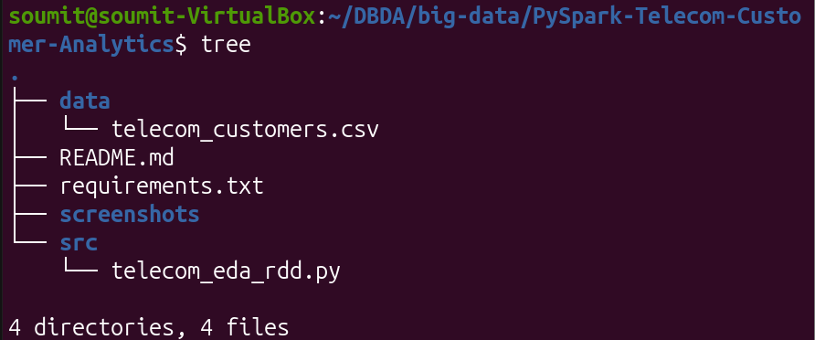
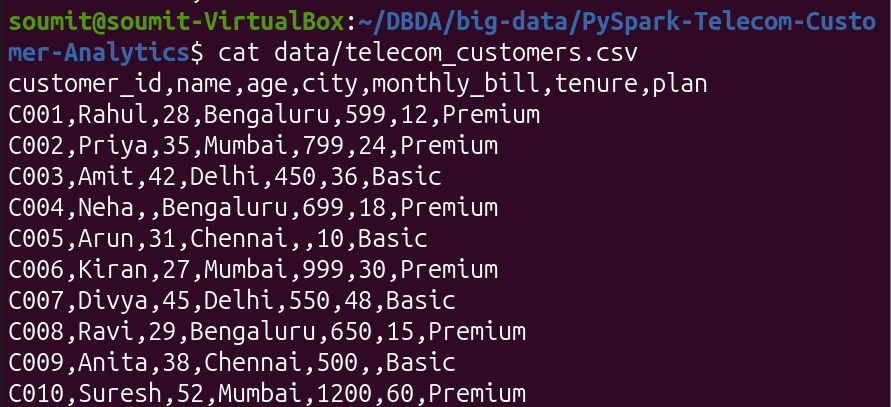
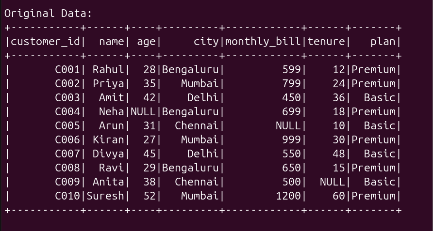
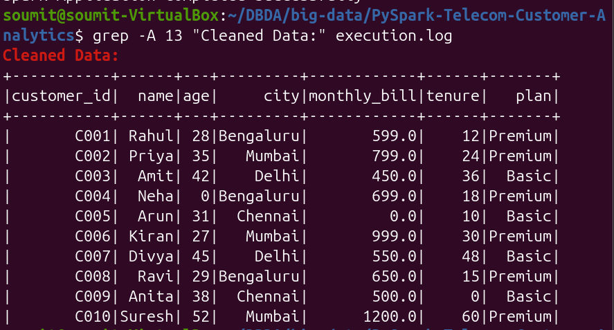
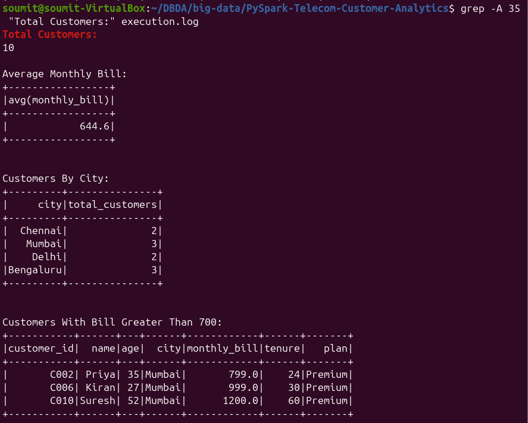
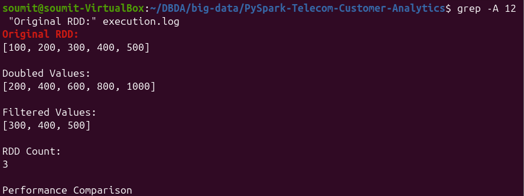
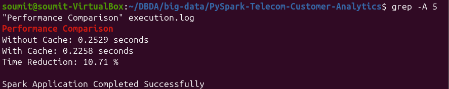
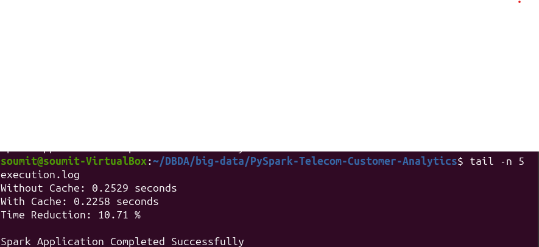

# PySpark Telecom Customer Analytics

A Big Data analytics project using **Apache PySpark** to process, clean, transform, and analyze telecom customer data. This project demonstrates DataFrame operations, RDD transformations, exploratory data analysis (EDA), and performance optimization using caching.

## Project Overview

The objective of this project is to analyze telecom customer information and extract useful business insights using Apache Spark.

The project covers:
- Loading customer data from a CSV file.
- Handling missing and NULL values.
- Data type conversion and preprocessing.
- Exploratory Data Analysis using Spark DataFrames.
- RDD creation and transformations.
- Performance optimization using `cache()`.

## Technology Stack

| Technology | Purpose |
|---|---|
| Python 3.14 | Programming language |
| Apache PySpark 4.2.0 | Distributed data processing |
| Apache Spark | Big Data processing engine |
| CSV | Input dataset |
| Ubuntu Linux | Development environment |
| Java 17 | Spark runtime |

## Project Structure

```text
PySpark-Telecom-Customer-Analytics/
│
├── data/
│   └── telecom_customers.csv
│
├── src/
│   └── telecom_eda_rdd.py
│
├── screenshots/
│   ├── 01_project_structure.png
│   ├── 02_dataset.png
│   ├── 03_original_data_schema.png
│   ├── 04_cleaned_data.png
│   ├── 05_eda_results.png
│   ├── 06_rdd_operations.png
│   ├── 07_cache_optimization.png
│   └── 08_successful_execution.png
│
├── requirements.txt
├── .gitignore
└── README.md
```

## Dataset Description

The project uses a sample telecom customer dataset containing 10 records.

| Column | Description |
|---|---|
| customer_id | Unique customer identifier |
| name | Customer name |
| age | Customer age |
| city | Customer location |
| monthly_bill | Monthly bill amount |
| tenure | Customer subscription duration |
| plan | Subscription plan (Basic/Premium) |

The dataset includes missing values to demonstrate data cleaning and preprocessing.

## Data Processing

The following preprocessing operations are performed:

1. Load the CSV dataset using Spark DataFrame.
2. Identify missing values.
3. Handle NULL values using `fillna()`.
4. Convert columns into appropriate data types.
5. Display the cleaned dataset and schema.

## Exploratory Data Analysis (EDA)

The project performs the following analysis:

- Total number of customers.
- Average monthly bill.
- Customer distribution by city.
- Customers with monthly bills greater than 700.
- Average monthly bill by subscription plan.

### Key Results

| Analysis | Result |
|---|---:|
| Total Customers | 10 |
| Average Monthly Bill | 644.60 |
| Bengaluru Customers | 3 |
| Mumbai Customers | 3 |
| Delhi Customers | 2 |
| Chennai Customers | 2 |
| Customers with Bill > 700 | 3 |

## RDD Operations

RDD operations are demonstrated using a sample collection.

**Original RDD**
```python
[100, 200, 300, 400, 500]
```

**Map Transformation**
```python
[200, 400, 600, 800, 1000]
```

**Filter Transformation**
```python
[300, 400, 500]
```

**RDD Count**
```text
3
```

Operations demonstrated:
- `parallelize()`
- `map()`
- `filter()`
- `collect()`
- `count()`

## Performance Optimization

Spark DataFrame caching is used to demonstrate performance optimization.

The execution time is compared before and after applying `cache()`.

Example result from one execution:

| Operation | Execution Time |
|---|---:|
| Without Cache | 0.2924 seconds |
| With Cache | 0.2243 seconds |
| Time Reduction | 23.29% |

**Note:** Execution times may vary depending on system resources and runtime conditions.

## Screenshots

### 1. Project Structure


### 2. Dataset


### 3. Original Data and Schema


### 4. Cleaned Data


### 5. EDA Results


### 6. RDD Operations


### 7. Cache Optimization


### 8. Successful Execution


## How to Run the Project

### Prerequisites

- Python 3.14
- Java 17
- Apache Spark 4.2.0
- PySpark 4.2.0

### Step 1: Clone the Repository

```bash
git clone https://github.com/SoumitBarate/PySpark-Telecom-Customer-Analytics.git
```

### Step 2: Navigate to the Project

```bash
cd PySpark-Telecom-Customer-Analytics
```

### Step 3: Install Dependencies

```bash
pip install -r requirements.txt
```

### Step 4: Execute the Project

```bash
spark-submit src/telecom_eda_rdd.py
```

## Key Learnings

- Working with Apache Spark and PySpark.
- Reading and processing CSV datasets.
- Data cleaning and preprocessing.
- Performing EDA using Spark DataFrames.
- Understanding RDD transformations and actions.
- Applying caching for performance optimization.
- Executing PySpark applications in a Linux environment.

